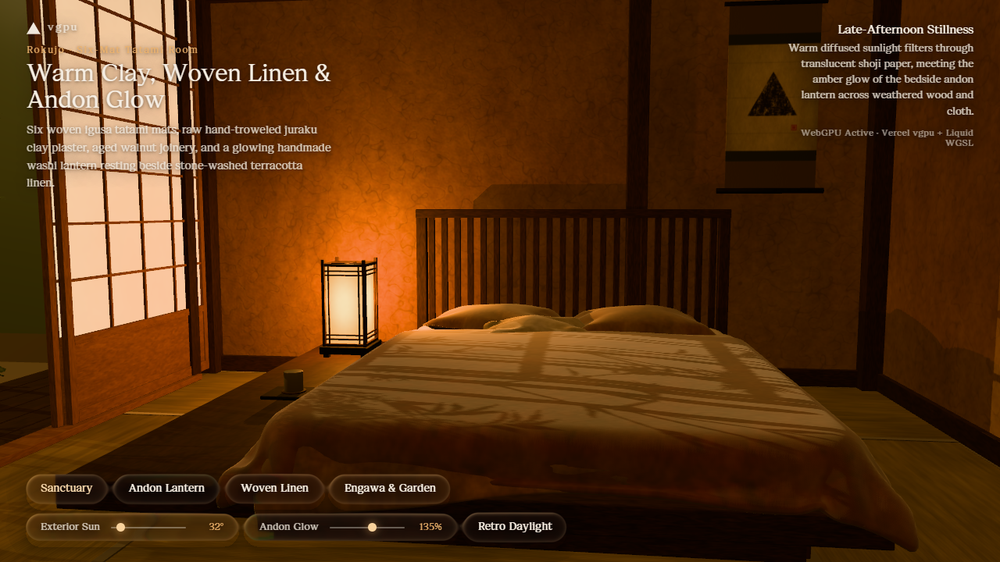
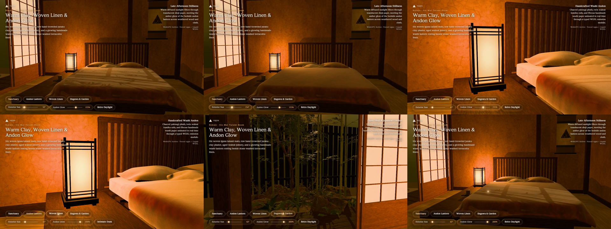
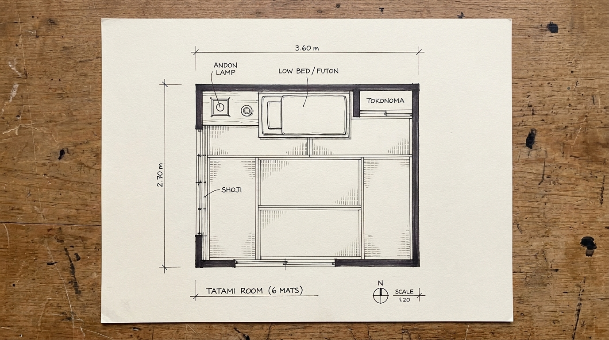
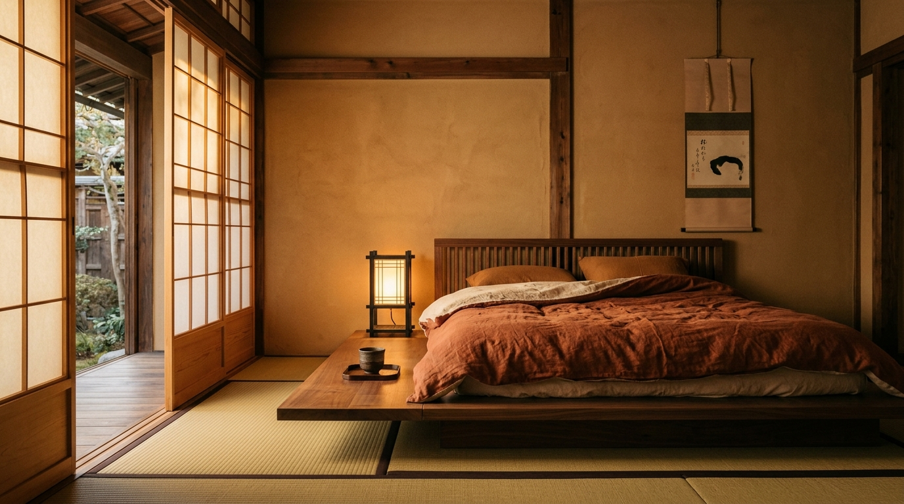
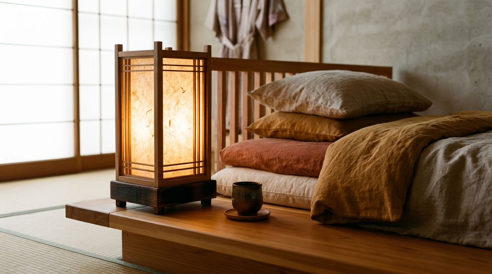
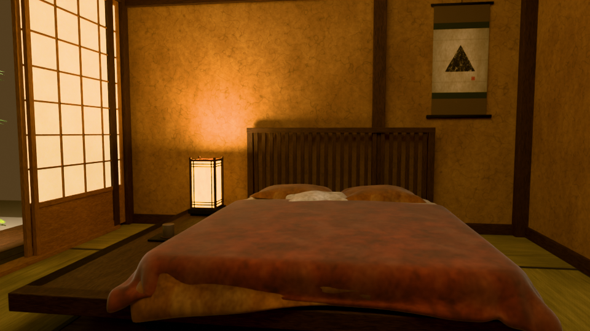
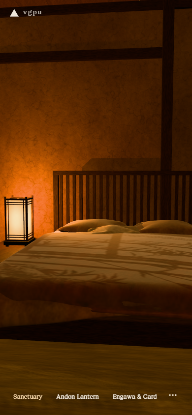

# Quiet Tatami Sanctuary — Blender 5.2 + Vercel `vgpu` (WebGPU)

> From a hand-drawn 6-tatami (*rokujo*) floor plan to a piece-by-piece Blender 5.2 scene with real Cloth physics, seamless 1024px *wabi-sabi* PBR textures, a Poly Haven CC0 Japanese garden, and a live WebGPU experience powered by **Vercel's `vgpu`** with typed WGSL shaders and refractive Liquid Glass controls.

**Live WebGPU Demo:** https://sala-japonesa-vgpu.vercel.app



---

## What's Inside

| Layer | Highlights |
|---|---|
| **Architectural Modeling (`blender/`)** | Traditional 6-mat *rokujo* Japanese bedroom (`3.60 m × 2.70 m × 2.55 m`) built 100% in Blender 5.2 Python: 6 alternating *tatami* mats with espresso *heri* borders, raw *juraku* clay plaster walls, aged walnut posts & *nageshi* beams, sliding *hinoki* *shoji* screens with individual *kumiko* strips, low platform bed with cantilevered bedside ledge, and a handcrafted *andon* washi lantern. |
| **Real Cloth Physics** | 45-frame Blender `Cloth` + `Cloth Pressure` simulation on the quilted stone-washed terracotta duvet, folded ochre throw blanket, cream linen sheet, and 3 flanged Oxford-border pillows — baked cleanly into the exported glTF/GLB mesh. |
| **Seamless 1024px *Wabi-Sabi* PBR** | Mathematically tileable 2D FFT spectral textures (`generate_textures.py`) with natural patina, wood scuffs, hairline plaster cracks, slubbed linen weave, and a weathered *sumi-e* Vercel hanging scroll (`kakejiku`). |
| **Exterior Japanese Garden** | Open *shoji* doors revealing a wooden *engawa* veranda, a connected bamboo grove (every leaf attached to real bamboo nodes & twigs), and CC0 mossy boulders, woodland ferns, shrubs, and a courtyard tree from [Poly Haven](https://polyhaven.com). |
| **WebGPU + Vercel `vgpu` (`web-vgpu/`)** | `THREE.WebGPURenderer` with Khronos Neutral tone mapping, typed WGSL modules (`washi.wgsl` via `vgpu/three` `tslExports`), native `vgpu` refractive **Liquid Glass SDF controls** (`liquid_hud.wgsl` adapted from `vgpu`'s `liquid-layout` gallery example), rotating 360° golden-hour IBL Environment, borderless **Geist Serif** editorial typography, and mobile-first responsive 3-dots (`⋯`) menu. |

### 12-Second Interactive WebGPU Tour

- Full 12s H.264 MP4 tour: [`media/tour_sala_japonesa_12s.mp4`](media/tour_sala_japonesa_12s.mp4)
- 6-frame visual audit sheet:



### Visual Progression (Floor Plan → Look-Dev → Cycles → Live WebGPU)

| Hand-Drawn Floor Plan | Look-Dev Hero Reference | Andon Detail Reference |
|---|---|---|
|  |  |  |

| Final Blender Cycles Render | Mobile Responsive WebGPU (`▲ vgpu` + `⋯` Menu) |
|---|---|
|  |  |

---

## Installing the Agent Skills (`arquiteto` + Vercel Labs `vgpu`)

To replicate this exact code-first 3D workflow — building scenes piece by piece in Blender and shipping them live to the browser in WebGPU — install just two skills globally:

```bash
# 1. Install the Arquiteto 3D skill (piece-by-piece Blender architecture, Cloth, PBR & toolkit)
npx skills add jhosephebtc/tatami-sanctuary-vgpu -g

# 2. Install Vercel Labs' official vgpu skill (WebGPU, WGSL modules & Blender-to-WebGPU pipeline)
npx skills add vercel-labs/vgpu -g
```

### Antigravity Global Plugin Setup (Optional)

If you use Google Antigravity and want the bundled `arquiteto` plugin with the always-on `vgpu` browser preference rule (`rules/AGENTS.md`):

```bash
# macOS / Linux
mkdir -p ~/.gemini/config/plugins/arquiteto
cp -r plugin/arquiteto/* ~/.gemini/config/plugins/arquiteto/
cp -r skills/arquiteto ~/.gemini/config/plugins/arquiteto/skills/arquiteto

# Windows (PowerShell)
New-Item -ItemType Directory -Force -Path "$env:USERPROFILE\.gemini\config\plugins\arquiteto\skills\arquiteto" | Out-Null
Copy-Item -Recurse -Force .\plugin\arquiteto\* "$env:USERPROFILE\.gemini\config\plugins\arquiteto\"
Copy-Item -Recurse -Force .\skills\arquiteto\* "$env:USERPROFILE\.gemini\config\plugins\arquiteto\skills\arquiteto\"
```

---

## Running the Project Locally

### Prerequisites

- **Node.js 22+** & `npm` (for `web-vgpu` and `vgpu` CLI)
- **Blender 4.2+** (tested on **Blender 5.2.2 LTS**) — only needed if regenerating the `.glb` from Python
- **Python 3.11+** with `pillow`, `numpy`, and `opencv-python` — only needed if regenerating PBR textures
- **FFmpeg** on `PATH` — only needed if re-recording the 12s MP4 tour

### 1. Run the Live WebGPU App (`web-vgpu/`)

```bash
cd web-vgpu
npm install
npm run dev
```

Open `http://localhost:4173/` in any WebGPU-capable browser (Chrome, Edge, Safari 26+, or Firefox Nightly).

Useful `vgpu` CLI commands inside `web-vgpu/`:

```bash
# Inspect installed vgpu version and bundled offline documentation
npm exec --no -- vgpu --version
npm exec --no -- vgpu docs ls
npm exec --no -- vgpu docs cat /guides/threejs.docs.md

# Search the official vgpu shader & WebGPU example gallery
npm exec --no -- vgpu examples search "liquid"
```

### 2. Rebuild the Blender Scene & Textures from Scratch (Optional)

```bash
# 1. Generate seamless 1024px wabi-sabi PBR textures + weathered Vercel scroll
python blender/generate_textures.py

# 2. Fetch CC0 Japanese garden plants & moss rocks from Poly Haven (1k glTF)
python blender/fetch_garden_assets.py

# 3. Build the scene in Blender, run 45-frame Cloth physics, add garden & export GLB
blender -b --factory-startup \
  -P blender/stage1_room.py \
  -P blender/stage2_bed.py \
  -P blender/stage3_lamp_and_light.py \
  -P blender/stage5_polish_cloth_plants_uvs.py \
  -P blender/stage5b_relink_materials_and_export.py \
  -P blender/stage6_japanese_garden.py \
  -P blender/stage6b_fix_garden_bounds.py
```

### 3. Record the 12-Second Interactive Tour MP4

With `npm run dev` running on `http://localhost:4173/`:

```bash
node record_tour.mjs
```

---

## Credits & License

- **WebGPU & WGSL tooling:** [Vercel Labs `vgpu`](https://github.com/vercel-labs/vgpu) (`liquid_hud.wgsl` inspired by `liquid-layout` in the `vgpu` examples gallery)
- **Exterior garden botanicals & moss rocks:** [Poly Haven](https://polyhaven.com) (CC0)
- **Typography:** Geist Serif (Vercel)
- **Code License:** MIT
